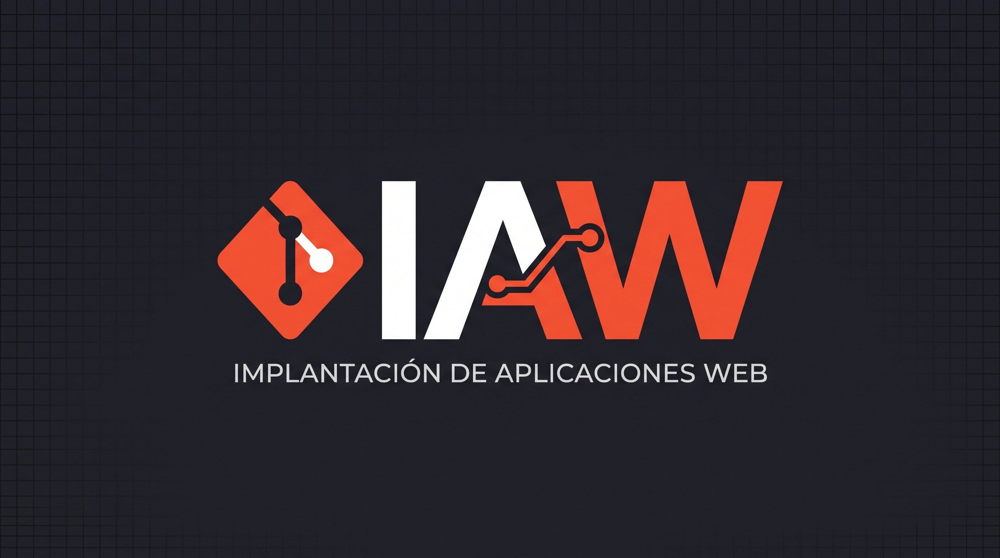

# IAW-web
## Proyecto de Implantación de Aplicaciones Web

Este repositorio es para la **asignatura IAW**, donde aprenderemos *Git y GitHub*.

### Tecnologías
1. HTML
2. CSS
3. Git

### Herramientas
- GitHub
- Linux
- VS Code

[Enlace a GitHub](https://github.com)

| Módulo | Curso |
|--------|-------|
| IAW    | 2º ASIR|

```bash
echo "Ejemplo de bloque de código"


